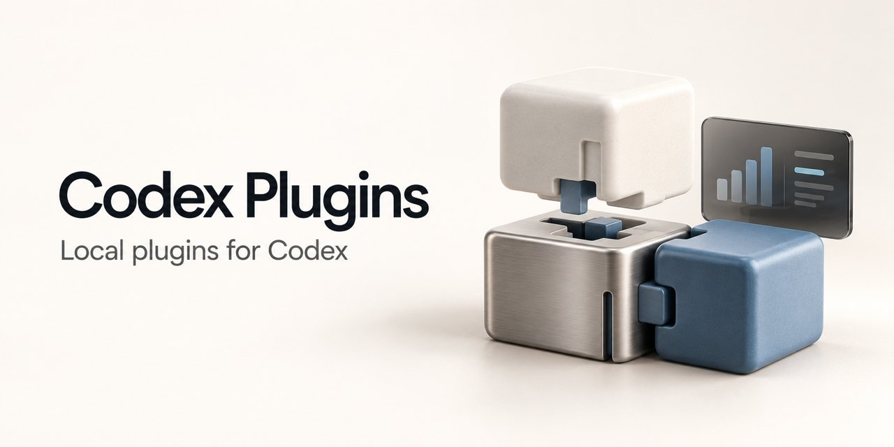

# Codex Plugins

English | [简体中文](README.zh-CN.md)


[](LICENSE)



A plugin marketplace for OpenAI Codex, maintained by Damao. Each plugin has its own version, and all of them install from this one marketplace. It currently ships one plugin, Session Stats, which shows token, turn, throughput and TTFT statistics for a local Codex session.

## Status

This is a personal project: plugins the author built for his own use of the Codex App, published so others can install them. Session Stats 0.1.2 is the first public release and has been verified on macOS with Codex CLI 0.159.0. You need the Codex App, a Codex CLI that supports plugins, and Python 3.12 or later available as `python3`. No API key or account beyond Codex itself is needed. The plugin's interface (metric names, scope buttons) is in Chinese.

Each plugin is released on its own: a tag and a GitHub release per version (for example `session-stats-v0.1.2`), with changes listed in the plugin's `CHANGELOG.md`. Codex installs and updates plugins from this repository through the marketplace. See [CONTRIBUTING.md](CONTRIBUTING.md) to report a bug or send a fix, and [SECURITY.md](SECURITY.md) for security problems.

## Install

Add the marketplace:

```sh
codex plugin marketplace add nervouna/codex-plugins
```

Then install the plugins you want:

```sh
codex plugin add session-stats@codex-plugins
```

Restart the Codex App and use the plugin in a new conversation.

## Plugins

| Plugin | What it does | Requirements |
| --- | --- | --- |
| [Session Stats](plugins/session-stats/README.md) | Shows a statistics snapshot of a local Codex session in the conversation | Codex App, a Codex CLI that supports plugins, Python 3.12+ |

### Session Stats

In a new conversation, type:

```text
$session-stats:session-stats
```

It reports on the current conversation by default. To report on another one, attach a `codex://threads/<session UUID>` link or reference the conversation with @. Only sessions stored on this machine are supported.

A local Python program reads the session, computes the metrics and writes the result. The model only runs the program and displays the snapshot it returns. The snapshot is a set of metric cards with three views: 合计 (combined, the default), 主会话 (main session) and 子代理 (child agents). The cards are:

- 总消耗 (total tokens), 输入 (input), 输入（缓存命中）(cached input), 输出 (output), 推理 (reasoning tokens)
- 缓存命中 (cache hit: cached input as a share of input), 推理占比 (reasoning share of output)
- 对话轮数 (turns), 平均 TTFT (mean time to first token), 端到端吞吐 (end-to-end throughput, token/s)
- 压缩次数 (compactions), 压缩耗时 (total compaction time)

Token counts of 10,000 or more are abbreviated with K and M, to one decimal place. Missing values show as `—`; the program does not estimate them. End-to-end throughput includes tool execution and waiting, TTFT uses the per-turn value Codex records, and child agent durations are summed per turn. Each call produces one fixed snapshot that does not refresh.

On the command line, the program prints a receipt that points at the files it wrote:

```text
$ python3 plugins/session-stats/scripts/session_stats.py snapshot --output-dir <dir> --timezone Asia/Taipei
{"json_path": "<dir>/session-stats-<hash>.json", "html_path": "<dir>/session-stats-<hash>.html", "reference": "…"}
```

`<hash>` is the first 16 hex digits of the snapshot's SHA-256, so the same snapshot is never written twice.

## Data and privacy

Session Stats only reads: the Codex session index (`state_*.sqlite`, opened read-only) and the session logs it points to, in the Codex home. The Codex home is `--codex-home` if given, then `$CODEX_HOME`, then `~/Library/Application Support/Codex/home` if it exists, then `~/.codex`. The plugin makes no network requests and calls no model API.

It writes two files per snapshot, an HTML fragment and a JSON file, into the output directory of the conversation that called it, so the conversation can show the snapshot again later. They contain identifiers, timestamps, numbers and diagnostic codes, not message text, tool arguments or tool output. Delete them when you no longer need them; the chart in that conversation will no longer display.

## Update

```sh
codex plugin marketplace upgrade codex-plugins
codex plugin add session-stats@codex-plugins
```

Restart the Codex App after updating. The plugin depends on the format of Codex's local records; if a field is missing, it shows `—` rather than guessing.

## Feedback

Report problems in this repository's Issues with the plugin version, the Codex version and your operating system. Do not upload raw session logs, credentials or private conversations.

## License

[MIT](LICENSE)
